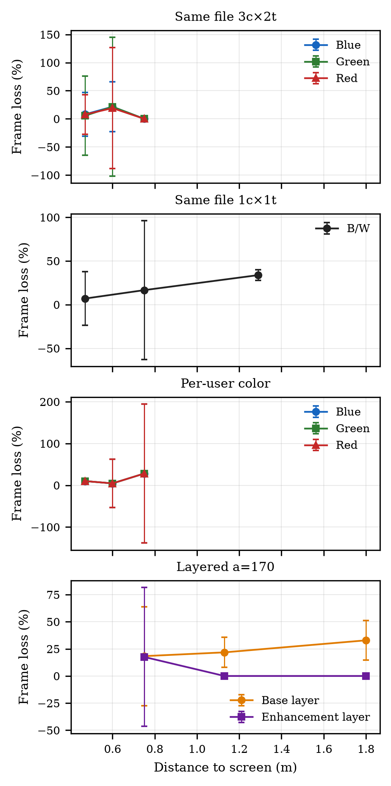
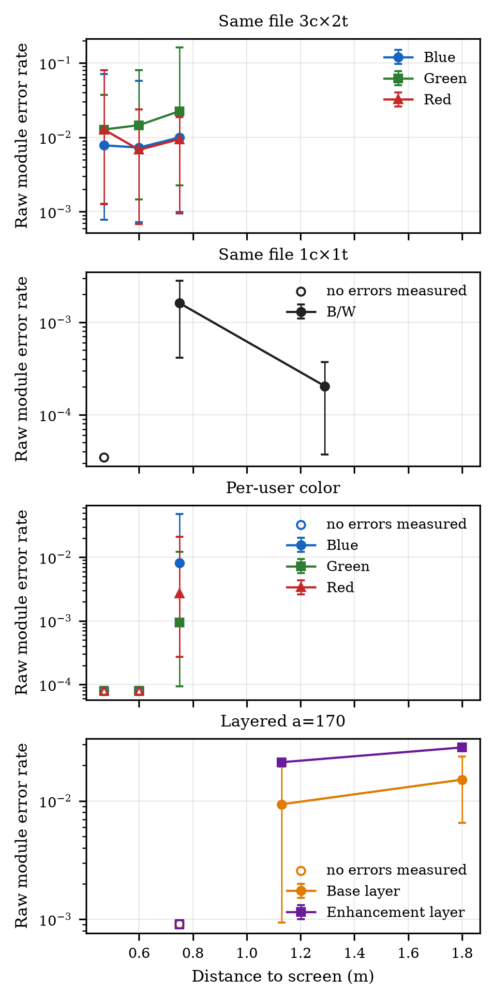
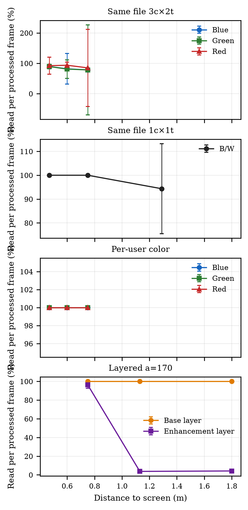
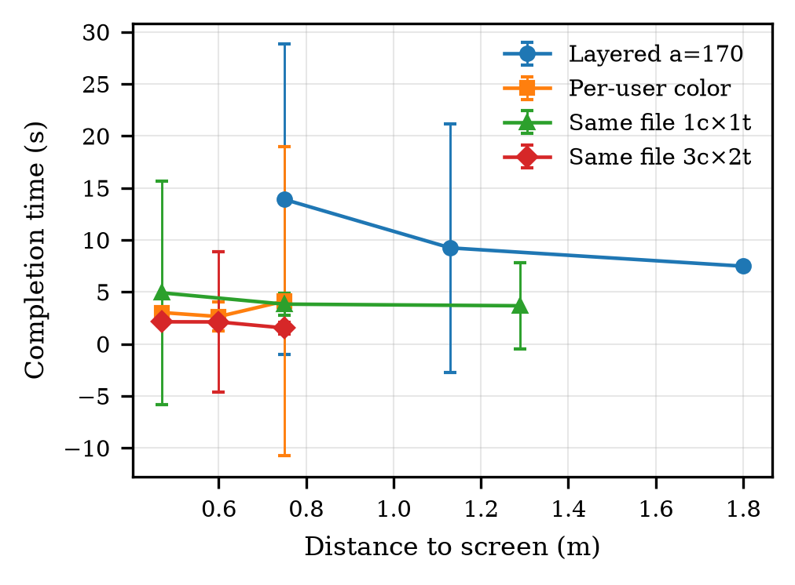
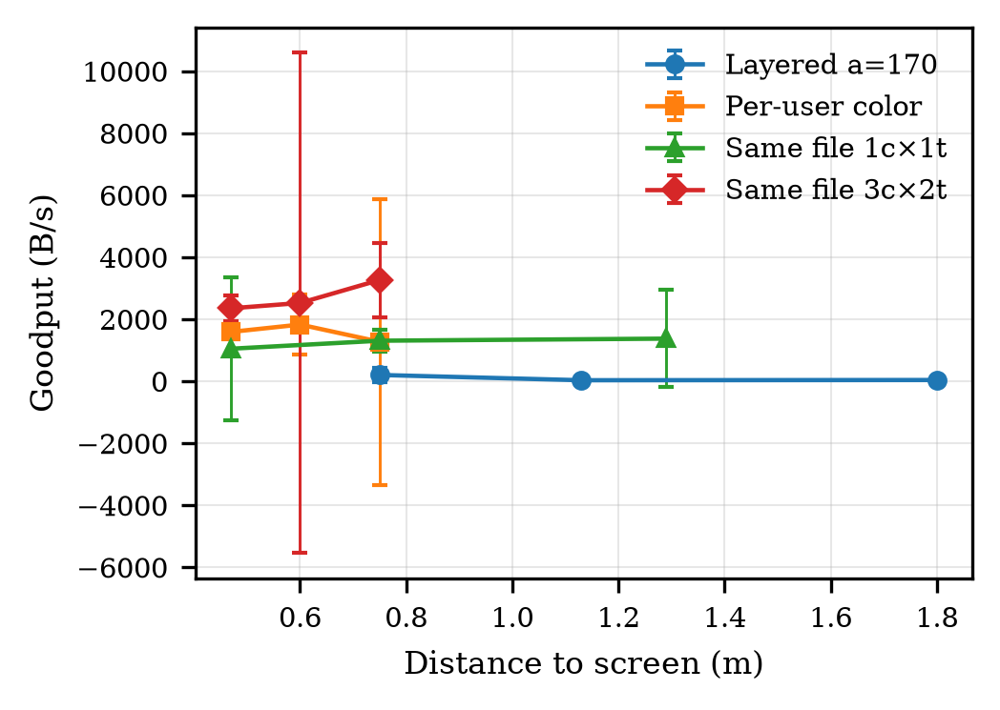
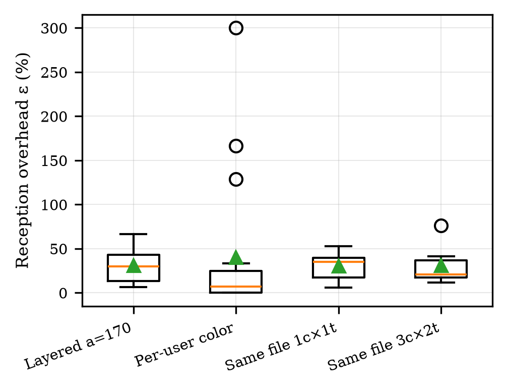
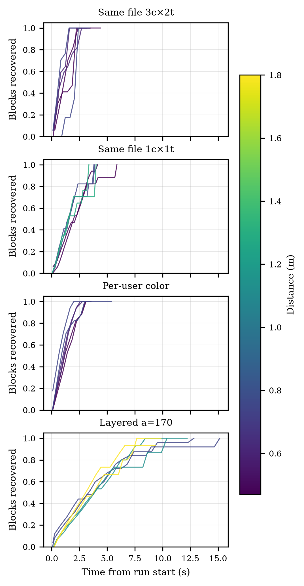

# QR Lab Results

24 runs, 422 processed frames and 829 QR reads from 1 dataset file(s). Updated 2026-10-21 19:05 UTC.

| Scheme | Distance (m) | Runs | Frame loss | Module errors | Completion (s) | Goodput (B/s) |
|---|---:|---:|---:|---:|---:|---:|
| Layered a=170 | 0.75 | 2 | 17.9 % | 0.0e+00 | 13.9 | 202.9 |
| Layered a=170 | 1.13 | 2 | 16.1 % | 9.7e-03 | 9.233 | 32.85 |
| Layered a=170 | 1.8 | 2 | 25.0 % | 1.6e-02 | 7.474 | 40.1 |
| Per-user color | 0.47 | 2 | 10.0 % | 0.0e+00 | 3.016 | 1592 |
| Per-user color | 0.6 | 2 | 4.5 % | 0.0e+00 | 2.631 | 1828 |
| Per-user color | 0.75 | 2 | 28.1 % | 4.0e-03 | 4.108 | 1272 |
| Same file 1c×1t | 0.47 | 2 | 7.0 % | 0.0e+00 | 4.911 | 1049 |
| Same file 1c×1t | 0.75 | 2 | 16.6 % | 1.6e-03 | 3.825 | 1308 |
| Same file 1c×1t | 1.29 | 2 | 33.8 % | 2.0e-04 | 3.667 | 1374 |
| Same file 3c×2t | 0.47 | 2 | 7.1 % | 1.1e-02 | 2.126 | 2353 |
| Same file 3c×2t | 0.6 | 2 | 20.7 % | 1.0e-02 | 2.115 | 2524 |
| Same file 3c×2t | 0.75 | 2 | 0.0 % | 1.5e-02 | 1.532 | 3266 |

### Frame loss per stream vs distance (mean ± 95 % CI over runs).

[PDF](fig_frame_loss_by_stream.pdf)

### Raw module error rate before QR error correction. Open markers: no errors measured.

[PDF](fig_module_error_rate.pdf)

### Share of processed camera frames in which each stream was read.

[PDF](fig_success_per_frame.pdf)

### Time from the first QR code to a verified file.

[PDF](fig_completion_time.pdf)

### Delivered bytes per second.

[PDF](fig_goodput.pdf)

### LT fountain reception overhead ε per completed file.

[PDF](fig_overhead.pdf)

### Fraction of blocks recovered over time, one line per run.

[PDF](fig_progress.pdf)

Tables: [summary_by_scheme.csv](summary_by_scheme.csv) · [summary_by_scheme.tex](summary_by_scheme.tex) · [summary_by_stream.csv](summary_by_stream.csv) · [METHODS.md](METHODS.md)
